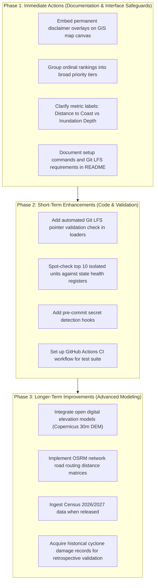

# Comprehensive Risk Assessment Report — Cyclone Preparedness Assistant

**Project**: Cyclone Preparedness Assistant  
**Repository**: `cyclone-preparedness-assistant`  
**Target Region**: Dakshina Kannada & Udupi Districts, Karnataka, India (622 Administrative Units)  
**Analytical Scope**: Spatial Accessibility, Coastal Proximity Heuristic, Multidimensional Prioritization Baseline & Unsupervised K-Means Vulnerability Clustering ($k=4$)  
**Date**: October 2026  

---

## 1. Project Overview and Assessment Scope

The **Cyclone Preparedness Assistant** is an academic decision-support project developed to explore spatial vulnerability patterns across the coastal districts of Dakshina Kannada and Udupi in Karnataka, India. The project encompasses 622 administrative spatial units (561 revenue villages and 61 Census towns).

### 1.1 Core Components of the System
The current project implementation consists of five interconnected subsystems:
1. **Spatial Data Pipeline**: Integrates socioeconomic attributes from the Census of India 2011 (District Census Handbooks), healthcare facility coordinates from the National Health Mission (NHM/MoHFW, 2015–2019), administrative village/town boundaries from the Socioeconomic High-resolution Rural-Urban Geographic platform (SHRUG v1.5), and coastline geometries from Natural Earth (10m scale).
2. **Feature Engineering Module**: Computes Euclidean straight-line distances to primary health centres/community health centres (PHC/CHC), taluk/district hospitals, and the Arabian Sea shoreline; constructs four standardized vulnerability dimension scores: Healthcare Accessibility Deficit ($D_{\text{health}}$), Demographic Vulnerability ($D_{\text{demo}}$), Infrastructure Deficit ($D_{\text{infra}}$), and Coastal Hazard Exposure ($D_{\text{coast}}$).
3. **Multidimensional Prioritization Baseline**: Implements a transparent, rule-based multi-criteria prioritization heuristic with configurable dimension weights and evaluates sensitivity across five distinct weighting scenarios.
4. **Unsupervised Vulnerability Clustering**: Benchmarks K-Means and Agglomerative Hierarchical Clustering (Ward linkage) across $k \in [2, 6]$, selecting a stable 4-cluster K-Means solution to discover empirical vulnerability archetypes.
5. **Decision-Support Delivery**: Delivers outputs through a FastAPI REST backend (`src/api/`) and a standalone interactive Leaflet/Folium GIS choropleth map (`reports/kmeans_cluster_map.html`), supported by experiment tracking (`src/tracking/wandb_logger.py`).

### 1.2 Purpose and Scope of this Assessment
Because this tool is designed for disaster preparedness and resource planning, errors in data, modeling, interpretation, or software engineering carry severe consequences. This report provides a structured, professional risk assessment that evaluates:
- **Data integrity and provenance risks** arising from historical or incomplete source datasets.
- **GIS and spatial risks** stemming from metric approximations and generalized geometries.
- **Modeling and analytical risks** related to heuristic weighting, normalization, and unsupervised clustering assumptions.
- **Operational and decision-support risks** regarding how human decision-makers might interpret or misapply outputs.
- **Software and infrastructure risks** affecting reproducibility, dependencies, and delivery.
- **Security and tracking risks** covering credential management and experiment provenance.

---

## 2. Risk Assessment Methodology

This assessment follows a qualitative risk analysis framework tailored to an academic decision-support engineering project.

### 2.1 Distinction of Core Concepts
To ensure analytical rigor and prevent confusion:
- **Prioritization Baseline vs. Clustering**: The multidimensional prioritization score is a **rule-based multi-criteria aggregation heuristic** designed to rank relative deficits based on user-defined weights. The K-Means model is an **unsupervised exploratory clustering algorithm** that groups units into empirical similarity archetypes based on multidimensional feature density. Neither is a supervised predictive model.
- **Descriptive Archetypes vs. Validated Risk Classes**: Discovered clusters (Clusters 0, 1, 2, and 3) represent **empirical similarity patterns** across the four standardized dimensions. They are **not** validated risk classifications, damage forecasts, or casualty probability groups.
- **Existing Controls vs. Proposed Mitigations**: In every assessment, mechanisms already built and verified in the codebase (e.g., automated assertions, test fixtures, disclaimer columns) are explicitly separated from recommended immediate and longer-term mitigations.
- **Confirmed Issues vs. Potential Risks**: Known historical limitations (e.g., 2011 Census vintage, straight-line distance approximations) are distinguished from plausible operational risks that have not yet manifested.

### 2.2 Mitigation Priority Criteria
Each identified risk is assigned a **Mitigation Priority** based on practical considerations:
- **High Priority**: Risks that directly affect life-safety decision-making, core analytical validity, or could lead users to fundamentally misinterpret the system's outputs. Requires immediate mitigation or prominent user-facing caveats.
- **Medium Priority**: Risks that degrade accuracy, cross-platform portability, or reproducibility under certain operational conditions, but do not invalidate the primary analytical outputs.
- **Low Priority**: Residual risks, edge cases, or configuration nuances that are already largely controlled by existing safeguards and require ongoing maintenance.

*Note: In strict compliance with project guidelines, this assessment does not utilize numerical risk scores, probability-impact products, or risk matrices.*

---

## 3. Data Risks and Mitigations

### Risk DATA-01: Outdated Demographic and Infrastructure Data (Census 2011 Vintage)
- **Category**: Data Risks
- **Description**: All demographic indicators (population, SC/ST counts, sex ratio) and village amenities (treated tap water, all-weather road connectivity, drainage systems) are derived from the 2011 Census of India (DCHB), which is over 15 years old. The national 2021 decennial census was postponed. Over the intervening decade and a half, Dakshina Kannada (particularly the Mangalore peri-urban corridor) and Udupi have experienced substantial suburbanization, population growth, infrastructure development, and demographic shifts.
- **Potential Impact**: Priority scores and clustering assignments for rapidly developing peri-urban fringes may reflect outdated infrastructure deficits that have since been modernized, or underestimate population counts exposed to coastal hazards.
- **Risk Mitigation**:
  - *Existing Controls*: Metadata disclaimer column (`census_vintage = "2011"`) explicitly appended to all Parquet schemas and reports; an optional population-scale variant using logarithmic compression ($\ln(1 + \text{population})$) was implemented to mitigate absolute scale distortions.
  - *Immediate Action*: Add prominent visual warnings in the interactive map and API responses explicitly informing users that demographic baselines represent 2011 conditions.
  - *Longer-Term Action*: Implement an ingestion module for intermediate proxy datasets, such as updated district electoral rolls, local panchayat administrative registers, or satellite-derived built-up area indices.
- **Mitigation Priority**: **High**. Demographic and infrastructure indicators drive two of the four primary vulnerability dimensions.

---

### Risk DATA-02: Missing, Inaccurate, or Inconsistent Healthcare Facility Information
- **Category**: Data Risks
- **Description**: Healthcare facility coordinates are sourced from the National Health Mission (NHM) / Ministry of Health and Family Welfare directory (vintage 2015–2019). The directory may contain closed facilities, outdated administrative classifications (e.g., subcentres upgraded to PHCs), unverified geocodes, and systematically excludes private nursing homes and specialized tertiary clinics that provide substantial trauma care in coastal Karnataka.
- **Potential Impact**: Spatial distance calculations to the "nearest" hospital or PHC may point to non-operational facilities, or conversely, underestimate accessibility by ignoring nearby private medical college hospitals (e.g., in Mangalore and Manipal).
- **Risk Mitigation**:
  - *Existing Controls*: Facility types were strictly stratified into primary triage (`dist_to_nearest_phc_chc_km`) and apex referral (`dist_to_nearest_hospital_km`); raw facility counts within units were excluded from scoring due to severe zero-inflation (78.8% zero for PHCs, 98.7% for hospitals).
  - *Immediate Action*: Perform manual spot-checks on the top 10 most healthcare-isolated units (e.g., Amasebailu, Edmoge, Madammakki) against Karnataka Directorate of Health & Family Welfare active registries.
  - *Longer-Term Action*: Incorporate crowdsourced OpenStreetMap healthcare points of interest (with verified operating tags) and official district health action plan registries.
- **Mitigation Priority**: **High**. Healthcare isolation is the defining characteristic of Cluster 1 (foothill communities).

---

### Risk DATA-03: Feature Missingness and Attribute Quality Issues
- **Category**: Data Risks
- **Description**: In raw census tables, several candidate vulnerability indicators suffer from substantial missingness. Most notably, the initial feature audit revealed that `literacy_rate` had 59.8% missing values in Dakshina Kannada (221 missing units out of 369). Other indicators, such as pucca road coverage, showed high multicollinearity ($r_s > 0.85$).
- **Potential Impact**: If missing attributes were naively imputed or included in joint scoring, district-wide comparisons would be systematically biased, penalizing or rewarding units based on reporting artifacts rather than actual conditions.
- **Risk Mitigation**:
  - *Existing Controls*: Strict indicator selection protocol: `literacy_rate` was entirely excluded from the multidimensional baseline; collinear features (`total_households`, `has_pucca_road`) were removed; all four retained dimension indicators have verified **0.0% missingness** across all 622 units.
  - *Immediate Action*: Maintain automated assertion tests (`assert df[col].notna().all()`) in the test suite to ensure no null values are introduced during upstream data updates.
  - *Longer-Term Action*: If literacy or education data become available from updated secondary surveys, evaluate inclusion only under an audited, transparent imputation framework.
- **Mitigation Priority**: **Medium**. The risk is well-contained by existing architectural decisions, but requires continuous test verification.

---

### Risk DATA-04: Geographic Matching and Boundary Misalignment Between Data Sources
- **Category**: Data Risks
- **Description**: The project joins socioeconomic attributes from Census 2011 to spatial boundary polygons from SHRUG v1.5 using administrative keys (`shrid2` and `pc11_id`). Administrative boundary shifts, changes in village names, or discrepancies in district coding between government census tables and spatial polygons can cause failed joins, duplicate mappings, or boundary mismatches.
- **Potential Impact**: Assigning demographic characteristics to the wrong geographic polygon, dropping valid villages during inner joins, or misallocating resources to adjacent administrative jurisdictions.
- **Risk Mitigation**:
  - *Existing Controls*: Strict join audit confirmed exactly 622 administrative units (561 villages, 61 Census towns); representative points were forced strictly inside polygon boundaries (`rep_point_strictly_inside=True`); non-contiguous multi-polygons were tracked via `n_ncontig`.
  - *Immediate Action*: Keep regression tests in `tests/test_data_integrity.py` verifying that all 622 units maintain unique, non-null identifiers and valid geometries.
  - *Longer-Term Action*: Build a cross-walk table documenting newer taluk reorganizations (e.g., the creation of Byndoor, Brahmavara, Kadaba, and Moodbidri taluks) relative to 2011 census boundaries.
- **Mitigation Priority**: **Medium**. Essential for spatial accuracy; currently validated across all units.

---

### Risk DATA-05: Raw Data Provenance, Licensing, and Upstream Reproducibility
- **Category**: Data Risks
- **Description**: Raw input datasets originate from multiple third-party providers with varying licenses (SHRUG from Development Data Lab with academic/non-commercial licensing; Natural Earth in public domain; Census 2011 under National Data Sharing and Accessibility Policy). Raw source files reside in `data/raw/` and are excluded from the Git repository due to file size constraints and license terms.
- **Potential Impact**: Independent researchers cloning the repository cannot run the raw-to-interim ingestion pipeline from scratch without manually locating, downloading, and placing raw files in specific directories.
- **Risk Mitigation**:
  - *Existing Controls*: Detailed provenance documentation maintained in `reports/data_inventory.md` and `reports/data_manifest.csv`, including source URLs, access dates, citations, and SHA-256 checksums; processed intermediate datasets are versioned via Git LFS.
  - *Immediate Action*: Add a clear "Data Acquisition Guide" in the project documentation detailing step-by-step instructions for downloading raw datasets.
  - *Longer-Term Action*: Provide synthetic mock sample files for automated testing of raw ingestion scripts without requiring multi-gigabyte raw data downloads.
- **Mitigation Priority**: **Medium**. Downstream reproducibility is preserved via processed Parquet files; raw data reproducibility requires documented manual steps.

---

## 4. GIS and Spatial Risks and Mitigations

### Risk GIS-01: Generalized Coastline Proximity Not Representing Hydrodynamic Inundation
- **Category**: GIS and Spatial Risks
- **Description**: Coastal hazard exposure ($D_{\text{coast}}$) is computed as inverted Euclidean distance to a generalized 10m-scale continental coastline (Natural Earth). This metric represents proximity to the open ocean, but completely omits elevation above sea level, local bathymetry, tidal inlets, storm-surge wave dynamics, estuarine river backwater surges, and coastal protection structures (sea walls).
- **Potential Impact**: Low-lying estuarine communities several kilometres inland (e.g., along the Netravati, Gurupura, or Swarna rivers) may receive artificially low exposure scores, while cliff-top communities directly on the shoreline may receive high exposure scores despite being elevated above surge reach.
- **Risk Mitigation**:
  - *Existing Controls*: The indicator is explicitly documented and labeled as a "Coastal Proximity Heuristic" (`dist_to_coastline_km`), not as a storm-surge flood depth or flood hazard prediction; disclaimer strings are stored in Parquet schemas.
  - *Immediate Action*: Ensure the interactive GIS map popup, legend, and API responses prominently label the metric as "Distance to Coast (km)" rather than "Storm Surge Exposure."
  - *Longer-Term Action*: Incorporate open digital elevation models (Copernicus or SRTM 30m DEM) to construct a coastal elevation profile (Low Elevation Coastal Zone — LECZ) as a secondary exposure feature.
- **Mitigation Priority**: **High**. Preventing users from confusing shoreline proximity with physical flood simulation is critical.

---

### Risk GIS-02: Straight-Line Euclidean Distances Diverging from Actual Road Transit Times
- **Category**: GIS and Spatial Risks
- **Description**: Distances to hospitals, primary health centres, and the coastline are calculated using Euclidean straight-line distance in projected coordinates (UTM Zone 43N). In the Western Ghats foothill zone (Belthangady, Sullia, Karkala), steep terrain, winding ghat roads (e.g., Shiradi and Charmadi passes), unbridged stream crossings, and seasonal landslide blocks cause actual road travel distances and travel times to be two to three times greater than straight-line calculations.
- **Potential Impact**: The model underestimates the physical and medical isolation of remote interior communities, potentially leading disaster managers to assume rapid ambulance access where roads are impassable during monsoon cyclones.
- **Risk Mitigation**:
  - *Existing Controls*: Documented as an explicit limitation in `reports/spatial_accessibility_report.md`; the unsupervised clustering successfully isolated foothill units into Cluster 1, where average straight-line hospital distance is already an extreme 23.6 km (peaking at 36.4 km).
  - *Immediate Action*: Add explicit notes in Cluster 1 popups indicating that actual road travel times will significantly exceed straight-line estimates.
  - *Longer-Term Action*: Integrate an open-source routing engine (OSRM or NetworkX) using OpenStreetMap road networks to compute actual road network distances and drive times under dry and flooded conditions.
- **Mitigation Priority**: **High**. Crucial for medical resource prepositioning and evacuation planning.

---

### Risk GIS-03: Coordinate Reference System (CRS) Transformation and Geometry Errors
- **Category**: GIS and Spatial Risks
- **Description**: Spatial data must transition between projected coordinates (EPSG:32643 / UTM Zone 43N in meters) for distance calculations and geographic coordinates (EPSG:4326 in degrees) for GeoJSON export and Leaflet mapping. Improper coordinate axis ordering, unprojected Euclidean distance math, or self-intersecting geometries can silently distort calculations.
- **Potential Impact**: Inaccurate distance values, failed point-in-polygon operations, or corrupted browser rendering.
- **Risk Mitigation**:
  - *Existing Controls*: The spatial pipeline strictly projects all layers to EPSG:32643 before distance calculations; geometries are validated and simplified (`tolerance=0.001`) for web display; 16 dedicated GIS tests in `tests/test_cluster_map.py` verify geometry and layer integrity.
  - *Immediate Action*: Maintain strict assertions in the preprocessing pipeline checking `gdf.crs.to_epsg() == 32643` during distance computations.
  - *Longer-Term Action*: Add automated topology healing (`shapely.validation.make_valid`) to ensure resilience against future source geometry updates.
- **Mitigation Priority**: **Low**. Robust engineering and automated tests currently control this risk.

---

### Risk GIS-04: Spatial Representation Distortion for Multi-Part Polygons
- **Category**: GIS and Spatial Risks
- **Description**: Several coastal and riverine revenue villages contain detached estuarine islands or discontiguous patches (`n_ncontig > 1`). Standard centroid calculations for concave or multi-part geometries can fall outside the administrative boundary (e.g., in a river or ocean).
- **Potential Impact**: Calculating facility distances from a centroid located in water bodies, misrepresenting the village's actual settlement location.
- **Risk Mitigation**:
  - *Existing Controls*: The spatial feature pipeline uses `geopandas.GeoSeries.representative_point()`, with an explicit verification flag (`rep_point_strictly_inside=True`) guaranteeing that every evaluation coordinate falls strictly within the polygon boundary.
  - *Immediate Action*: Retain test assertions verifying `df["rep_point_strictly_inside"].all()`.
  - *Longer-Term Action*: Weight representative points by census hamlet locations or settlement clusters where sub-village point data exist.
- **Mitigation Priority**: **Low**. Already completely resolved in code through representative point enforcement.

---

### Risk GIS-05: External Basemap Tile Server Outage or Watermark Degradation
- **Category**: GIS and Spatial Risks
- **Description**: The interactive HTML map (`reports/kmeans_cluster_map.html`) relies on external web tile servers (CartoDB Positron CDN) to render background street and terrain maps behind the administrative polygons. Tile servers may experience downtime, return HTTP 403 errors due to policy changes, or display watermarks ("API KEY REQUIRED") if usage policies change.
- **Potential Impact**: Users opening the map in an emergency control room without reliable internet, or under changed tile terms, see a blank gray background or intrusive watermarks behind administrative polygons.
- **Risk Mitigation**:
  - *Existing Controls*: Administrative polygons, popups, and legends are bundled self-contained into a single standalone HTML file (~1 MB) that renders all analytical outputs regardless of tile status; Leaflet is configured with standard open tile CDN endpoints.
  - *Immediate Action*: Test tile loading across different network conditions and provide alternative tile provider URLs (e.g. Esri World Topo, OSM mirrors) in script configuration.
  - *Longer-Term Action*: Package an offline mbtiles base layer or allow the tool to toggle a plain local SVG/canvas vector backdrop for disconnected field operations.
- **Mitigation Priority**: **Medium**. Affects field usability during communication blackouts.

---

## 5. Modeling and Analytical Risks and Mitigations

### Risk MOD-01: Subjective Weighting in the Multidimensional Prioritization Score
- **Category**: Modeling and Analytical Risks
- **Description**: The composite priority score in the baseline model aggregates the four dimensions using equal weights ($w_i = 0.25$). Equal weighting represents an arbitrary normative assumption that a 1-unit deficit in healthcare access is equivalent to a 1-unit deficit in coastal proximity or demographic vulnerability.
- **Potential Impact**: In an active cyclone, shoreline flood threats far outweigh long-term healthcare deficits; in an inland heavy rainfall event, foothill isolation outweighs coastal distance. Hardcoded weights can misdirect preparedness priorities.
- **Risk Mitigation**:
  - *Existing Controls*: A comprehensive sensitivity analysis was conducted and documented across five contrasting weighting schemes (Equal Weights, Hazard-Dominant, Access-Dominant, No-Coastal Inland, and Population-Scaled); the FastAPI backend (`POST /api/v1/prioritization/scenario`) supports dynamic weighting; rank variance metrics (`rank_mean`, `rank_std`, `rank_shift_span`) are precomputed for all units.
  - *Immediate Action*: Document that the equal-weights baseline is an exploratory starting point, and encourage decision-makers to evaluate the scenario rank span rather than a single static rank.
  - *Longer-Term Action*: Implement an Analytical Hierarchy Process (AHP) or stakeholder elicitation workshop with local disaster management officials to calibrate weights for specific disaster phases.
- **Mitigation Priority**: **High**. Directly governs the primary ranking mechanism.

---

### Risk MOD-02: Sensitivity of Normalization to Extreme Outlier Values
- **Category**: Modeling and Analytical Risks
- **Description**: The prioritization baseline applies min-max scaling ($[0.0, 1.0]$) to normalize indicators. Min-max normalization is highly sensitive to extreme outliers, such as Mangalore City Corporation (population 499,487 vs. rural hamlets under 500) or Madammakki (hospital distance 36.4 km).
- **Potential Impact**: Extreme maximum values compress the variance of the remaining 95% of administrative units into narrow bands, diminishing the discriminative power of the scoring system for typical rural villages.
- **Risk Mitigation**:
  - *Existing Controls*: Population is transformed logarithmically ($\ln(1 + \text{population})$) in the population-scale variant; K-Means clustering features use z-score standardization (`StandardScaler`) rather than min-max scaling; median-to-mean centroid ratios were audited to verify that outliers do not skew cluster centers.
  - *Immediate Action*: Maintain documented quantile distributions ($p_{25}, p_{50}, p_{75}$) alongside min-max ranges in data summaries.
  - *Longer-Term Action*: Evaluate robust scaling (interquartile range scaling) or quantile transformation as configurable options in the prioritization pipeline.
- **Mitigation Priority**: **Medium**. Managed effectively by log-scaling and standardization, but requires ongoing monitoring.

---

### Risk MOD-03: Multicollinearity and Variable Over-Counting
- **Category**: Modeling and Analytical Risks
- **Description**: Including multiple variables that measure the same underlying construct (e.g. household count and population count, or pucca road and all-weather road) artificially doubles the influence of that latent factor in composite scoring.
- **Potential Impact**: Over-emphasizing settlement size or infrastructure type, distorting composite rankings.
- **Risk Mitigation**:
  - *Existing Controls*: A formal feature audit in `reports/coastal_exposure_and_feature_audit_report.md` pruned redundant candidates: `total_households` ($r_s = +0.99$ with population) was excluded; `has_pucca_road` ($r_s > 0.85$ with `has_all_weather_road`) was excluded; each dimension uses strictly non-collinear features.
  - *Immediate Action*: Retain unit tests verifying that all selected indicators within each dimension maintain low pairwise correlation.
  - *Longer-Term Action*: Conduct periodic Principal Component Analysis (PCA) to confirm that the four conceptual dimensions remain statistically independent.
- **Mitigation Priority**: **Low**. Confirmed, audited, and resolved in the codebase.

---

### Risk MOD-04: K-Means Geometric Assumptions and Cluster Count Selection
- **Category**: Modeling and Analytical Risks
- **Description**: K-Means clustering assumes spherical, isotropic clusters of roughly equal variance. Real-world multidimensional vulnerability data may form non-convex, elongated, or density-varying clusters. Furthermore, selecting $k=4$ over $k=3$ or $k=5$ involves an analytical judgment call balancing mathematical parsimony against domain interpretability.
- **Potential Impact**: Forcing transitional communities near cluster boundaries into arbitrary discrete buckets; potentially masking sub-cluster nuances.
- **Risk Mitigation**:
  - *Existing Controls*: Benchmarked K-Means against Agglomerative Hierarchical Clustering (Ward linkage) across $k=2..6$; selected $k=4$ based on peak inter-algorithm agreement (**Adjusted Rand Index ARI = 0.7575**, AMI = 0.7183) and exceptional random-seed stability (**Mean ARI = 0.9912** across 10 seeds); verified that all clusters are well-populated ($82 \le N_c \le 249$).
  - *Immediate Action*: Emphasize in reports that cluster boundaries represent continuous gradations in 4D feature space rather than sharp administrative divisions.
  - *Longer-Term Action*: Implement soft-clustering models (such as Gaussian Mixture Models) that output probabilistic cluster membership probabilities.
- **Mitigation Priority**: **Medium**. Rigorously validated mathematically, but requires clear conceptual communication.

---

### Risk MOD-05: Cluster Labels Being Misinterpreted as Validated Risk Classifications
- **Category**: Modeling and Analytical Risks
- **Description**: Descriptive archetype labels—such as "Urban & Peri-Urban Well-Resourced Corridor" or "High-Exposure Coastal Rural Belt"—may be misinterpreted by operational personnel as certified disaster risk categories or verified damage severity tiers.
- **Potential Impact**: Responders assuming that all units in Cluster 3 face catastrophic damage while Cluster 0 is completely safe, leading to inappropriate deployment decisions.
- **Risk Mitigation**:
  - *Existing Controls*: Structurally labeled throughout the codebase and reports as "Vulnerability Archetypes," explicitly disclaiming predictive validity; alert boxes in reports emphasize they are descriptive hypotheses.
  - *Immediate Action*: Maintain explicit disclaimers in map popups, API schemas, and report headers clarifying that archetypes describe shared structural characteristics, not predicted cyclone impact.
  - *Longer-Term Action*: Publish a user guide explaining how to interpret archetype profiles alongside local ground intelligence.
- **Mitigation Priority**: **High**. Critical conceptual boundary to prevent decision misuse.

---

### Risk MOD-06: Absence of Verified Historical Impact Labels and Validated Supervised Model
- **Category**: Modeling and Analytical Risks
- **Description**: The project does not possess granular historical cyclone damage data (e.g. village-level structural damage, inundation depths, crop loss, or casualties from Cyclone Tauktae 2021, Cyclone Ockhi 2017, or historical Arabian Sea storms). Consequently, the project cannot train or validate a supervised machine-learning model (such as a Random Forest or XGBoost damage classifier) against ground-truth outcomes.
- **Potential Impact**: Inability to compute standard empirical performance metrics (e.g., accuracy, precision, recall, F1-score, AUC-ROC, or RMSE) to validate whether higher-ranked or higher-exposure units actually suffer greater disaster losses.
- **Risk Mitigation**:
  - *Existing Controls*: Explicitly framing the project as an **analytical prioritization baseline and unsupervised archetype discovery tool**, strictly rejecting any fabrication of synthetic ground truth or unverified predictive accuracy claims.
  - *Immediate Action*: Ensure that all academic and technical documentation clearly distinguishes between empirical exploratory clustering and supervised prediction.
  - *Longer-Term Action*: Partner with the Karnataka State Disaster Management Authority (KSDMA) or district disaster management cells to acquire historical post-cyclone damage assessment records for retrospective validation.
- **Mitigation Priority**: **High**. Fundamental to the scientific integrity and scope of the project.

---

### Risk MOD-07: Users Interpreting Prioritization Scores as Damage Probabilities
- **Category**: Modeling and Analytical Risks
- **Description**: A user viewing a priority score of `0.7018` (e.g., for Edmoge village) may interpret this number as a "70.2% probability of experiencing cyclone damage or casualties."
- **Potential Impact**: Widespread misunderstanding, unwarranted public panic, or inappropriate emergency resource commitments based on a false probabilistic interpretation.
- **Risk Mitigation**:
  - *Existing Controls*: All documentation explicitly defines the score as a normalized multi-criteria deficit index ($[0.0, 1.0]$), where higher values indicate greater compounding baseline deficits across health, demographics, infrastructure, and coastal proximity.
  - *Immediate Action*: Label UI displays with clear descriptive phrasing (e.g., "Priority Deficit Score: 0.70 / 1.00 — Relative Baseline Need Index") rather than bare percentages or unqualified scores.
  - *Longer-Term Action*: Present scores primarily through ordinal ranks, percentiles, or categorical priority tiers (e.g. Top 10%, Top Quartile) to discourage probabilistic misinterpretation.
- **Mitigation Priority**: **High**. Essential communication safeguard for non-technical stakeholders.

---

## 6. Operational and Decision-Support Risks and Mitigations

### Risk OPS-01: Incorrect Preparedness Decisions Based on Incomplete or Outdated Information
- **Category**: Operational and Decision-Support Risks
- **Description**: If disaster managers rely solely on the assistant's outputs during an active disaster without cross-referencing real-time ground intelligence, decisions regarding shelter activation, boat deployments, or medical team dispatches could be based on outdated 2011 infrastructure status or straight-line distance assumptions.
- **Potential Impact**: Deploying rescue boats where water has already receded, sending evacuees to shelters with compromised access, or neglecting newly developed vulnerable settlements.
- **Risk Mitigation**:
  - *Existing Controls*: System design report (`reports/decision_support_design_report.md`) explicitly defines the assistant as a **pre-monsoon preparedness and long-term planning tool**, not a tactical real-time cyclone landfall dispatch engine.
  - *Immediate Action*: Add an explicit operational banner: "Decision-Support Prototype: Designed for pre-disaster planning and vulnerability assessment. Not certified for tactical real-time evacuation routing."
  - *Longer-Term Action*: Build integration adapters for real-time India Meteorological Department (IMD) cyclone track bulletins and district emergency operation centre situational reports.
- **Mitigation Priority**: **High**. Protects life-safety operational integrity.

---

### Risk OPS-02: Overreliance on Exact Priority Rankings
- **Category**: Operational and Decision-Support Risks
- **Description**: Decision-makers may treat the 1-to-622 ranking as a strict, immutable hierarchy, allocating resources to Rank 1 (Edmoge, score 0.7018) while completely ignoring Rank 15 (Kollamogru, score 0.6189) or Rank 25, despite negligible mathematical differences between adjacent units.
- **Potential Impact**: Arbitrary "cliff-edge" funding and resource cutoffs; neglecting communities that have severe localized needs not captured by the four macro-dimensions.
- **Risk Mitigation**:
  - *Existing Controls*: Sensitivity analysis precomputes `rank_min`, `rank_max`, and `rank_shift_span` for every unit; documentation emphasizes that the top 14 units form a robust tier across all scenarios rather than a rigid sequence.
  - *Immediate Action*: Group rankings into broader action tiers (e.g. Tier 1 Critical Need: Ranks 1–50; Tier 2 Moderate Need: Ranks 51–150) in all summary reports and presentations.
  - *Longer-Term Action*: Display rank uncertainty bands (error bars / confidence intervals) alongside numerical ranks in the user interface.
- **Mitigation Priority**: **High**. Prevents automation bias and artificial precision.

---

### Risk OPS-03: Misinterpretation of Vulnerability Archetypes Across Units
- **Category**: Operational and Decision-Support Risks
- **Description**: Decision-makers may assume that all 249 units in Cluster 3 (Coastal Belt) or all 161 units in Cluster 2 (Rural Interior) have identical operational constraints, applying uniform, broad-brush relief packages without checking unit-specific indicators.
- **Potential Impact**: Over-supplying coastal desalination kits to coastal units that already have municipal tap water, or failing to recognize that a coastal unit also has acute hospital isolation.
- **Risk Mitigation**:
  - *Existing Controls*: Every unit in `coastal_vulnerability_archetypes.parquet` preserves its underlying raw metrics and individual dimension scores ($D_{\text{health}}, D_{\text{demo}}, D_{\text{infra}}, D_{\text{coast}}$); map popups display all four dimension values alongside the cluster label.
  - *Immediate Action*: Include guidance in documentation reminding users to check individual dimension scores when designing specific interventions.
  - *Longer-Term Action*: Generate community-specific "Vulnerability Factsheets" that highlight both the archetype profile and specific local metric outliers.
- **Mitigation Priority**: **Medium**. Mitigated by maintaining granular dimension visibility.

---

### Risk OPS-04: Healthcare Accessibility Measures Not Reflecting Operational Capacity
- **Category**: Operational and Decision-Support Risks
- **Description**: The healthcare accessibility deficit measures proximity (km), but provides no information regarding whether a facility is open 24/7, has emergency power backup generators, possesses operating surgical theatres, has antivenom/blood banks, or has available hospital beds.
- **Potential Impact**: Directing mass casualties to a nearby primary health centre that is unstaffed, without electricity, or flooded during a cyclone.
- **Risk Mitigation**:
  - *Existing Controls*: Separated primary health centres (outpatient triage) from taluk/district hospitals (inpatient/trauma care); documented as an accessibility proxy rather than a capacity index.
  - *Immediate Action*: Explicitly state in healthcare accessibility sections that distances represent physical proximity, not clinical capacity, bed availability, or disaster readiness.
  - *Longer-Term Action*: Collaborate with district health offices to incorporate facility operational tier ratings (e.g., 24x7 PHC status, ICU bed count, emergency generator status).
- **Mitigation Priority**: **High**. Direct medical consequence during emergency aftermath.

---

### Risk OPS-05: Insufficient Communication of Uncertainty and Analytical Assumptions
- **Category**: Operational and Decision-Support Risks
- **Description**: Delivering analytical outputs with high cartographic and visual polish (interactive Folium maps, clean vector polygons, 4-decimal precision) can create an illusion of absolute certainty, obscuring the underlying heuristic assumptions, vintage limitations, and spatial approximations.
- **Potential Impact**: Non-technical decision-makers accepting model recommendations without exercising appropriate professional skepticism or conducting necessary ground verification.
- **Risk Mitigation**:
  - *Existing Controls*: Prominent warning notices in all generated Markdown reports; metadata disclaimer fields stored within processed Parquet files.
  - *Immediate Action*: Add a permanent "Data Limitations & Assumptions" legend box directly on the interactive cluster map canvas.
  - *Longer-Term Action*: Create an executive summary brief specifically written for district administrative officers detailing model boundaries and appropriate use cases.
- **Mitigation Priority**: **High**. Essential ethical safeguard for applied decision-support tools.

---

## 7. Software and Infrastructure Risks and Mitigations

### Risk SFT-01: Dependency Conflicts and Geospatial C-Library Incompatibility
- **Category**: Software and Infrastructure Risks
- **Description**: Geospatial Python libraries (GeoPandas, Shapely, PyProj, GDAL, Fiona) depend heavily on underlying compiled C-libraries (GEOS, PROJ, GDAL). Incompatibilities between operating systems (Ubuntu/Linux vs macOS vs Windows), differing wheel binaries, or updates to dependencies can break local environments and CI pipelines.
- **Potential Impact**: Inability of collaborators, evaluators, or deployment environments to install or run the project; build failures during package installation.
- **Risk Mitigation**:
  - *Existing Controls*: Centralized `pyproject.toml` configuration pinning modern, compatible versions; local virtual environment (`.venv`) tested and passing all 103 test cases.
  - *Immediate Action*: Document exact supported Python version (`3.11` to `3.14`) and virtual environment setup commands in `README.md`.
  - *Longer-Term Action*: Provide a minimal Dockerfile and a Conda `environment.yml` lockfile to ensure identical, containerized builds across diverse platforms.
- **Mitigation Priority**: **Medium**. Currently stable, but cross-platform portability requires containerization.

---

### Risk SFT-02: Code Defects, Untested Edge Cases, and Test Suite Regression
- **Category**: Software and Infrastructure Risks
- **Description**: Unhandled edge cases—such as zero-population units, requests for non-existent administrative identifiers in API endpoints, invalid custom weighting configurations, or empty geometry inputs—could cause runtime crashes or silent analytical corruption.
- **Potential Impact**: System crashes during live demonstrations or evaluations; API 500 internal server errors; incorrect calculation cascades.
- **Risk Mitigation**:
  - *Existing Controls*: Robust test suite consisting of **103 passing tests across 14 test files** covering data integrity, spatial operations, feature engineering, clustering stability, API schemas, and GIS map generation.
  - *Immediate Action*: Retain the mandatory practice of running `pytest` before any code changes are accepted.
  - *Longer-Term Action*: Integrate an automated GitHub Actions CI workflow to execute the entire test suite on every pull request or commit.
- **Mitigation Priority**: **Low**. Strong test coverage provides robust protection against regressions.

---

### Risk SFT-03: Missing Source Data Files Preventing Full Pipeline Reproduction
- **Category**: Software and Infrastructure Risks
- **Description**: The raw data directory (`data/raw/`) is excluded from Git to prevent repository bloat. If a user attempts to execute upstream feature-engineering scripts (`run_eda_and_subset.py`, `engineer_coastal_features.py`) without having manually downloaded raw files, the scripts will terminate with `FileNotFoundError`.
- **Potential Impact**: An external evaluator cannot verify the complete raw-to-processed data transformation pipeline from scratch.
- **Risk Mitigation**:
  - *Existing Controls*: All downstream modeling, API, and mapping scripts read directly from precomputed, verified Parquet artifacts in `data/processed/`, which are fully tracked via Git LFS; manifests document raw file requirements.
  - *Immediate Action*: Add graceful file existence checks in data engineering scripts that print clear instructions directing users to `data_manifest.json` if raw files are absent.
  - *Longer-Term Action*: Create a public research data deposit (e.g. Zenodo) with a companion shell script (`scripts/download_raw_data.sh`) to automate raw data fetching.
- **Mitigation Priority**: **Medium**. Downstream functionality is fully reproducible; raw reproduction requires manual data staging.

---

### Risk SFT-04: Git LFS Bandwidth Limits and Pointer Stub Failures
- **Category**: Software and Infrastructure Risks
- **Description**: Parquet files in `data/interim/` and `data/processed/` are tracked using Git Large File Storage (Git LFS) as specified in `.gitattributes`. If Git LFS is not installed on a user's machine, or if GitHub account LFS bandwidth quotas are exceeded, Git clones will download tiny text pointer files (~130 bytes) instead of real binary files.
- **Potential Impact**: Subsequent executions of Python scripts crash with `pyarrow.lib.ArrowInvalid` or `parquet parsing error` when attempting to read pointer stubs.
- **Risk Mitigation**:
  - *Existing Controls*: Processed Parquet files are lightweight (~1.1 MB for `coastal_vulnerability_archetypes.parquet`), minimizing LFS quota consumption; `.gitattributes` explicitly configures tracking.
  - *Immediate Action*: Add a validation check in utility loaders that verifies file size ($> 10\text{ KB}$) and detects Git LFS pointer headers (`version https://git-lfs.github.com/spec/v1`).
  - *Longer-Term Action*: Document `git lfs pull` commands prominently in the project setup instructions.
- **Mitigation Priority**: **Medium**. Common stumbling block for evaluators cloning Git LFS repositories.

---

### Risk SFT-05: External Service Deprecation and Map Tile Disruption
- **Category**: Software and Infrastructure Risks
- **Description**: The standalone map relies on external Content Delivery Networks (CDNs) for Leaflet CSS/JS assets and basemap raster tiles. If CDN domains change, require authentication, or experience network timeouts, map functionality is impaired.
- **Potential Impact**: Broken map controls, missing stylesheets, or blank backgrounds when opening `reports/kmeans_cluster_map.html`.
- **Risk Mitigation**:
  - *Existing Controls*: Tested and verified that the generated map uses stable, publicly accessible CDN endpoints; administrative boundaries and clustering colors render independently of tile availability.
  - *Immediate Action*: Verify that map scripts use HTTPS tile endpoints with verified cross-origin permissions.
  - *Longer-Term Action*: Bundle essential Leaflet JS and CSS libraries directly into the repository for fully self-contained offline execution.
- **Mitigation Priority**: **Low**. Existing standalone map functions reliably across major browsers.

---

## 8. Security and Experiment-Tracking Risks and Mitigations

### Risk SEC-01: Accidental Exposure of Credentials and API Keys
- **Category**: Security and Experiment-Tracking Risks
- **Description**: The project integrates Weights & Biases for experiment tracking, which requires an API key. Developers may accidentally hardcode API keys in scripts or commit `.env` files containing sensitive credentials to public GitHub repositories.
- **Potential Impact**: Compromise of personal W&B accounts, unauthorized resource usage, API rate-limiting, and security compliance violations.
- **Risk Mitigation**:
  - *Existing Controls*: `.gitignore` explicitly excludes `.env`, `.env.*`, and `wandb/` directories; `src/tracking/wandb_logger.py` strictly accesses credentials via `os.environ.get("WANDB_API_KEY")` with no hardcoded fallback values.
  - *Immediate Action*: Run automated git history scans (`git log -S "wandb"`) to verify that no secret keys have ever been committed to the repository history.
  - *Longer-Term Action*: Install pre-commit hooks (e.g. `detect-secrets`) to prevent credentials from being staged in future commits.
- **Mitigation Priority**: **Medium**. Effectively controlled by `.gitignore`, but defense-in-depth scanning provides necessary assurance.

---

### Risk SEC-02: Accidental Inclusion of Large Raw Datasets in Git History
- **Category**: Security and Experiment-Tracking Risks
- **Description**: Staging large raw files from `data/raw/` (e.g. uncompressed spatial shapefiles, national census CSVs exceeding 100 MB) into ordinary Git commits causes repository bloat and exceeds GitHub's maximum file size limit (100 MB).
- **Potential Impact**: Failed git pushes, permanently bloated `.git` directory size, slow clone times, and potential license violations if redistributing restricted datasets.
- **Risk Mitigation**:
  - *Existing Controls*: `data/raw/` is explicitly ignored in `.gitignore`; `.gitattributes` tracks only specific processed Parquet files with Git LFS; reports and manifests are explicitly whitelisted as standard text files.
  - *Immediate Action*: Maintain vigilance when staging files; verify `git status` before committing.
  - *Longer-Term Action*: Add a pre-push hook that rejects any individual file commit exceeding 20 MB unless tracked by Git LFS.
- **Mitigation Priority**: **Low**. Controlled by existing `.gitignore` and `.gitattributes` configuration.

---

### Risk SEC-03: Incomplete Experiment Lineage and Metadata Tracking
- **Category**: Security and Experiment-Tracking Risks
- **Description**: Machine-learning experiments that do not record git commit hashes, random seeds, exact dependency versions, or parameter configurations become impossible to reproduce when software packages are updated or code is modified.
- **Potential Impact**: Inability to reproduce exact silhouette scores, centroid values, or cluster assignments reported in academic papers or project deliverables.
- **Risk Mitigation**:
  - *Existing Controls*: `src/tracking/wandb_logger.py` records complete run metadata (algorithm, cluster count, seed, silhouette, Davies-Bouldin, Calinski-Harabasz, cluster sizes); random seeds are fixed (`seed=42`); manifests are saved locally in structured JSON format (`reports/clustering_experiments_manifest.json`).
  - *Immediate Action*: Ensure that all reported metrics in project documentation explicitly cite the fixed random seed (`seed=42`) and exact dataset version.
  - *Longer-Term Action*: Automatically log the current Git commit hash and Python environment lockfile within the W&B run configuration.
- **Mitigation Priority**: **Low**. Dual tracking (W&B online + local JSON manifest) provides solid experiment lineage.

---

### Risk SEC-04: Tracking Service Outages and Inaccessible Experiment Dashboards
- **Category**: Security and Experiment-Tracking Risks
- **Description**: Relying exclusively on a cloud-hosted software-as-a-service (W&B cloud) creates a single point of failure if the tracking service experiences downtime, changes pricing tiers, or if the user's internet connection fails.
- **Potential Impact**: Inability to inspect experiment runs, evaluate model comparison charts, or access historical parameter logs during presentations or evaluations.
- **Risk Mitigation**:
  - *Existing Controls*: Resilient offline fallback built into `src/tracking/wandb_logger.py`: if `WANDB_API_KEY` is not found or cloud connection fails, the system logs the full experiment run to `reports/clustering_experiments_manifest.json` and continues pipeline execution without crashing.
  - *Immediate Action*: Ensure local JSON manifests are committed to Git so evaluators can inspect experiment records without requiring a W&B account.
  - *Longer-Term Action*: Generate static HTML or Markdown experiment comparison summaries directly from local JSON manifests.
- **Mitigation Priority**: **Low**. Fully insulated by existing offline fallback architecture.

---

## 9. Top Risks Requiring Immediate Attention

Among the 28 specific risks identified across the six categories, the following **five risks represent the most consequential challenges** to the project's analytical integrity, ethical use, and practical usefulness:

| Rank | Risk ID | Risk Name | Category | Primary Concern | Immediate Action Required |
| :---: | :---: | :--- | :--- | :--- | :--- |
| **1** | **MOD-05 & MOD-07** | **Ground-Truth Conflation & Damage Probability Misinterpretation** | Modeling / Analytical | Users interpreting heuristic priority scores as damage probabilities, or treating descriptive K-Means archetypes as validated disaster casualty classifications. | Embed clear, explicit disclaimers in all map tooltips, API responses, and report headers clarifying that outputs are relative baseline deficit indices, NOT empirical damage forecasts. |
| **2** | **DATA-01** | **Census 2011 Vintage Staleness** | Data Risks | Demographic and infrastructure data are 15 years old, missing modern suburbanization and infrastructure upgrades in coastal Karnataka. | Add prominent vintage warnings in documentation; utilize log-transformed population scaling to reduce historic scale distortion. |
| **3** | **GIS-01** | **Coastline Proximity vs. Real Flood Inundation** | GIS & Spatial | Straight-line distance to generalized coastline does not account for elevation, storm surge, or estuarine backwater flooding. | Explicitly label metrics as "Distance to Coastline (km)" rather than "Storm Surge Exposure" across all visual and API interfaces. |
| **4** | **GIS-02 & OPS-04** | **Straight-Line Distance vs. Actual Road Transit & Facility Readiness** | GIS / Operational | Euclidean distance ignores Western Ghats winding roads and monsoon washouts; proximity does not reflect hospital bed capacity or 24/7 emergency readiness. | Add operational caveats in Cluster 1 popups indicating that actual transit times significantly exceed straight-line estimates and that facility capacity must be verified. |
| **5** | **OPS-01 & OPS-02** | **Tactical Misuse & Overreliance on Ordinal Ranks** | Operational / Decision-Support | Decision-makers applying rigid rank cutoffs (#1 vs #2) or attempting to use planning heuristics for real-time tactical evacuation routing. | Add an operational scope banner stating the tool is designed for pre-season preparedness planning, not live tactical dispatch; group rankings into broad priority tiers. |

---

## 10. Recommended Mitigation Roadmap

To manage project risks in a manner practical and proportionate to a college-level academic project, recommended mitigation actions are structured into three chronological phases:

### 10.1 Phase 1: Immediate Actions (Documentation and Interface Safeguards)
*Target: Complete within current project sprint. Focuses on preventing misinterpretation without altering core analytical code.*
1. **Prominent Interface Disclaimers**: Add a clear, permanent disclaimer note on the interactive Folium map (`reports/kmeans_cluster_map.html`) explicitly stating: *"Analytical Baseline & Vulnerability Archetypes for Pre-Disaster Planning. Not a validated cyclone impact forecast or damage prediction model."*
2. **Descriptive Metric Labeling**: Verify that all table headers, map popups, and API responses label coastal proximity as *"Distance to Coastline (km)"* and healthcare access as *"Straight-Line Distance to Facility (km)"*.
3. **Tier-Based Prioritization Guidance**: Emphasize tier-based grouping (e.g. Top Tier: Ranks 1–50; Moderate Tier: Ranks 51–150) in all project summaries to discourage rigid reliance on minor rank differences.
4. **Setup Documentation**: Update `README.md` with explicit instructions regarding Python version requirements, virtual environment setup, and `git lfs pull` commands.

### 10.2 Phase 2: Short-Term Enhancements (Codebase and Validation Improvements)
*Target: Complete in subsequent development iteration. Enhances code robustness and data verification.*
1. **LFS Pointer Health Check**: Add an automated check in data loading utilities that inspects Parquet file headers and flags an informative error if a Git LFS pointer text file is detected instead of a real binary file.
2. **Healthcare Spot-Checks**: Conduct manual verification of facility operating status for the top 10 most isolated units (e.g., Edmoge, Amasebailu, Madammakki, Byndoor) against current Karnataka Directorate of Health & Family Welfare directories.
3. **Secret Scanning**: Verify repository clean status and introduce pre-commit hooks (`detect-secrets`) to prevent credentials or raw data files from being staged.
4. **Automated CI Workflow**: Establish a GitHub Actions workflow that executes the complete 103-test pytest suite on every commit to ensure zero regressions.

### 10.3 Phase 3: Longer-Term Research Improvements
*Target: Future project scope or post-academic expansion.*
1. **Topographic Elevation Integration**: Incorporate digital elevation models (SRTM or Copernicus 30m DEM) to calculate height above sea level, identifying low-lying coastal flood zones and distinguishing elevated coastal bluffs from flood-prone estuarine plains.
2. **Network Road Routing**: Replace Euclidean distance approximations with real road network distances and transit times computed via OpenStreetMap road graphs (OSRM / NetworkX), simulating road closures during severe weather.
3. **Updated Census Ingestion**: When the delayed national census is conducted and released, update demographic and amenity feature extraction pipelines using the existing modular architecture.
4. **Retrospective Disaster Validation**: Partner with district disaster management authorities to acquire empirical damage records from past cyclone events (e.g. Cyclone Tauktae 2021) to evaluate how well baseline vulnerability scores correlate with actual post-disaster relief demand.

---

## 11. Residual Risks and Project Limitations

Even after implementing all recommended mitigations, several **fundamental residual risks and methodological limitations** will remain inherent to the project's current design:

1. **Heuristic Nature of Multi-Criteria Decision Analysis**:
   No mathematical formula can objectively establish the "correct" relative weights between healthcare distance, demographic disadvantage, infrastructure deficits, and coastal proximity. All composite scores remain decision-support heuristics that reflect specific planning assumptions rather than objective physical laws.
2. **Inherent Delay in Public Geospatial and Census Datasets**:
   Comprehensive village-level demographic and infrastructure data in India are only collected decennially. Academic and operational systems relying on official administrative data will always operate with an inherent multi-year lag relative to real-time ground realities.
3. **Absence of Real-Time Meteorological Coupling**:
   The assistant assesses static baseline vulnerability. It does not ingest dynamic meteorological forecasts, such as real-time cyclone track cones, central pressure drops, forward speed, or radius of maximum winds. Actual cyclone damage depends heavily on storm-specific landfall characteristics that static vulnerability models cannot anticipate.
4. **Unsupervised Boundary Ambiguity**:
   The four vulnerability archetypes represent clusters in continuous mathematical space. While mathematically stable and domain-interpretable, boundary units will always exhibit characteristics of multiple archetypes. Assigning a single discrete cluster ID to a geographic unit is a simplification necessary for visualization, but should not obscure internal complexity.

---

## 12. Conclusion

The Cyclone Preparedness Assistant provides a defensible, mathematically validated analytical foundation for disaster preparedness planning across coastal Karnataka. By systematically separating raw data from analytical baselines, conducting transparent sensitivity audits, benchmarking multiple clustering algorithms, and maintaining a 103-test regression suite, the project demonstrates strong software engineering practices.

However, the transition from an analytical model to a practical decision-support tool introduces critical risks:
- The danger of users mistaking **descriptive archetypes** for **validated damage predictions**.
- The confusion between **coastal straight-line proximity** and **hydrodynamic flood depth**.
- The operational risks of relying on **2011 census baselines** and **straight-line distance approximations** in rugged Western Ghats terrain.

By implementing the Phase 1 interface disclaimers, adopting tier-based prioritization, conducting healthcare ground checks, and clearly communicating analytical boundaries, the project can maximize its educational and decision-support value while safeguarding against misuse in life-safety operational environments.

---

*Report prepared as part of the Cyclone Preparedness Assistant System Governance and Risk Management Framework.*  
*Related artifacts: [reports/multidimensional_prioritization_report.md](file:///home/bhavanish/cyclone-preparedness-assistant/reports/multidimensional_prioritization_report.md) · [reports/unsupervised_vulnerability_archetypes_report.md](file:///home/bhavanish/cyclone-preparedness-assistant/reports/unsupervised_vulnerability_archetypes_report.md) · [reports/kmeans_cluster_map.html](file:///home/bhavanish/cyclone-preparedness-assistant/reports/kmeans_cluster_map.html).*
